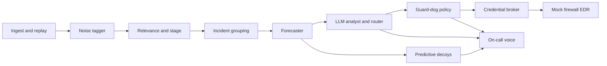

# On-Call Security Teammate

A local 24/7 security teammate for teams without a SOC. It triages AIT-ADS alerts, forecasts the next attack stage, places predictive decoys on localhost, and phones the on-call engineer for irreversible actions. The dashboard is the audit trail, not the product. Alert content stays on the machine; only short plain-language summaries leave when notification keys are set.

## Architecture



## Quick start

```bash
make setup && make train && make library && make demo
```

Open http://127.0.0.1:5173

## Free services and keys

Twilio voice, PagerDuty Events API v2, optional Telegram. See `docs/SETUP_KEYS.md` and `.env.example`. With no keys, the phone simulator and built-in on-call page cover the demo. Credentials are read only by the credential broker.

## Data split

- Training: fox, harrison, shaw, wardbeck, wheeler, wilson
- Held-out demo/validation: russellmitchell, santos
- GroupKFold k=6 by scenario on training only

## Classifier comparison

Three methods compared on the same splits: alert-type lookup, hand-written rules, logistic regression. Selected from CV only: **lookup** (rare-stage macro F1 0.302 vs rules 0.177 vs logistic 0.172). Details in `reports/method_comparison.md`.

## Honest results and limits

- Synthetic AIT-ADS data; one multi-step playbook repeated across 8 scenarios.
- Labels are time windows; `event_label` preferred when present.
- What-if view assumes blocking a stage stops later stages.
- Exfil playbook deliberately withheld so the sandbox/library path fires.
- Decys bind only to 127.0.0.1. Attacker simulator is labeled simulated.
- Twilio trial can only call verified numbers and plays a trial notice.
- Spoken audio uses local Kokoro when available, otherwise macOS `say`; demo mode is an original pitched-up voice, not a character clone.

## Isolation guarantees

- Decys: 127.0.0.1, unprivileged ports, no real shells.
- Guard-dog: untrusted fields delimited as data; allow/whitelist actions rejected; irreversible actions need approval.
- No credentials in prompts, logs, or model context.

## Dataset citation

AIT Alert Data Set (AIT-ADS), CC BY 4.0.

Landauer, M., Skopik, F., Wurzenberger, M. (2024). Introducing a New Alert Data Set for Multi-Step Attack Analysis. Proceedings of the 17th Cyber Security Experimentation and Test Workshop.
